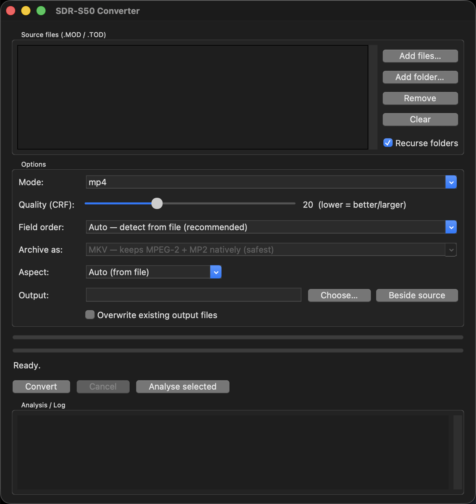

# SDR-S50 Converter

A small, dependency-free tool for turning Panasonic/JVC camcorder **`.MOD` /
`.TOD`** files (as produced by the Panasonic **SDR-S50** and many JVC Everio /
Canon SD camcorders) into clean, modern **MP4** — or into a lossless archive.



Under the hood a `.MOD` file is just an **MPEG-2 Program Stream** with an
unusual extension. It plays nowhere by default, and it's **interlaced**, so on a
progressive display it shows comb artefacts. This tool deinterlaces, rescales to
square pixels (so 16:9 anamorphic footage looks right), preserves the PAL colour
characteristics, and carries the recording timestamp from the sidecar `.MOI`
into the output.

There are two front-ends over the same engine:

| | |
|---|---|
| **`mod_convert_gui.py`** | A Tkinter desktop GUI — analyse, pick options, Convert. |
| **`mod-convert.sh`** | A batch CLI for scripting and large collections. |

## What's actually in a .MOD file

Run the analysis before converting — the GUI's **Analyse selected** button, or
`./mod-convert.sh -i file.MOD`. For a real SDR-S50 clip it reports:

```
MOV00E.MOD
  File          3.8 MB
  Container     mpeg   (a .MOD is really an MPEG-2 Program Stream)
  Video         mpeg2video 720x576
  Aspect        SAR 64:45  ->  DAR 16:9  ->  square-pixel output 1024x576
  Frame rate    25 fps  ->  50 fps after field-doubling
  Scan          interlaced, top field first (TFF)
  Duration      4.80 s
  Colour        bt470bg   (PAL)
  Audio         mp2, 48000 Hz, 2 ch, 256 kbit/s
  Recorded      2026-05-08 14:58:49   (from MOV00E.MOI)
  -> Deinterlace with parity=tff. If motion looks jerky or combed, force the other order.
```

Two things worth knowing about this material:

- **It is genuinely interlaced, not 25p.** Every frame is flagged
  `interlaced_frame=1, top_field_first=1`, and ffmpeg's content-based `idet`
  filter agrees: 120 of 120 frames detected as TFF, zero progressive, no
  pulldown. The 25 fps figure refers to 25 interlaced *frames* — i.e. 50 fields
  per second of real temporal resolution. That is why the default mode outputs
  50p: it keeps all 50 field samples instead of discarding half of them.
- **The 16:9 flag is correct here.** SAR 64:45 gives a 16:9 display aspect, so
  the classic MOD bug (16:9 content carrying a 4:3 header) does not apply to
  this file. Use `-a 16:9` only for files where it does.

## The three modes

| Mode | What it does | Output |
|---|---|---|
| **`mp4`** *(default)* | H.264/AAC, `bwdif` with field-doubling → **50p**, square pixels. Keeps the temporal resolution of the interlacing. | `.mp4` |
| **`mp4-25p`** | Same chain, fields woven to **25p**. Smaller, less smooth motion. | `.mp4` |
| **`archive`** | Lossless remux — video/audio streams copied untouched. | `.mkv` **or** `.mp4` |

### Field order — the artefact control

Deinterlacing with the wrong field order is *the* classic source of juddering,
combed motion. It matters more than people expect: encoding the same clip with
`parity=tff` and `parity=bff` produces images that differ by **SSIM 0.81** —
visibly broken, not a subtlety.

`auto` reads the field order from the stream and is right for well-flagged files
like the sample above. Override it (`-f tff` / `-f bff`, or the GUI dropdown)
when the flag lies or when motion looks wrong. Forcing an order also *enables*
deinterlacing on files that falsely claim to be progressive.

### Archive container — MKV or MP4

Both are lossless; verified by comparing the MD5 of the copied video and audio
streams against the source — bit-identical in both containers.

- **MKV** (default) stores MPEG-2 video and MP2 audio natively. Safest.
- **MP4** also remuxes losslessly, but MP2 audio in MP4 is an awkward
  combination — some players (notably QuickTime) may not decode the audio.
  Use it when you need MP4 specifically.

## Downloads

Each GitHub **Release** ships prebuilt binaries, produced by the
[`Build release binaries`](.github/workflows/release.yml) workflow:

- **macOS** — `SDR-S50-Converter.dmg` (Apple Silicon). Open it and drag the app
  to Applications. It's unsigned, so the first launch needs
  **right-click → Open** to get past Gatekeeper.
- **Windows** — `SDR-S50-Converter.exe` (single file, no install).

**These are fully self-contained** — Python, Tk *and* ffmpeg/ffprobe are bundled
in. Nothing to install, no PATH setup. The bundled ffmpeg is a GPL build (needed
for libx264); see [THIRD-PARTY.md](THIRD-PARTY.md).

The bundling makes the downloads large (roughly 90 MB on macOS, ~120 MB on
Windows). The Windows single-file build also unpacks itself on every launch, so
the first window takes a few seconds to appear. To build small binaries instead,
drop the two `--add-binary` lines from the workflow — the app then falls back to
whatever ffmpeg it finds on `PATH`.

To cut a release, publish a GitHub Release (tag) and the workflow builds and
attaches both files automatically. You can also trigger it manually from the
Actions tab (**workflow_dispatch**).

## Requirements

*(Only when running from source — the prebuilt downloads need none of this.)*

- **ffmpeg** and **ffprobe** on your `PATH` — `brew install ffmpeg` on macOS.
  Alternatively drop the two binaries into a `vendor/` folder next to the
  scripts, or point `SDRS50_FFMPEG_DIR` at a folder containing them; both take
  precedence over `PATH`.
- For the GUI: **Python 3.9+ with Tkinter**. The python.org and Homebrew Python
  builds include it. (`python3 -c "import tkinter"` should not error.)

## GUI

```bash
python3 mod_convert_gui.py
```

Add files or a folder, press **Analyse selected** to see the format details,
then pick a mode, quality, field order and output folder and hit **Convert**.
Progress is shown per-file and overall; conversions run on a background thread
so the window stays responsive. **Cancel** stops after terminating the current
ffmpeg and removes the partial output.

## CLI

```bash
./mod-convert.sh -i /Volumes/SD                     # analyse only, convert nothing
./mod-convert.sh /Volumes/SD/SD_VIDEO/PRG001        # everything -> MP4 50p
./mod-convert.sh -m archive -c mp4 clip.MOD         # lossless, but as .mp4
./mod-convert.sh -f bff clip.MOD                    # fix a wrong field order
./mod-convert.sh -a 16:9 MOV0*.MOD                  # force the aspect flag
./mod-convert.sh -q 22 clip.MOD                     # smaller files
```

```
Options:
  -m MODE   mp4 (default) | mp4-25p | archive
  -o DIR    output folder (default: next to each source file)
  -q CRF    x264 quality, lower = better/larger (default: 20)
  -a A:B    force display aspect (e.g. 16:9)
  -f ORDER  field order: auto (default) | tff | bff
  -c CONT   archive container: mkv (default) | mp4
  -i        analyse only: print format details, convert nothing
  -y        overwrite existing outputs
  -h        help
```

### The one-liner, without the script

```bash
ffmpeg -fflags +genpts -i MOV00E.MOD \
  -vf "bwdif=mode=send_field:parity=tff,scale=trunc(iw*sar/2)*2:ih:flags=lanczos,setsar=1" \
  -c:v libx264 -crf 20 -pix_fmt yuv420p \
  -colorspace bt470bg -color_primaries bt470bg -color_trc bt470bg \
  -c:a aac -b:a 192k -movflags +faststart MOV00E.mp4
```

The colour flags matter: PAL material is **BT.470BG**, and without tagging it
players assume BT.709 and the colours shift. The tool applies the source's own
colour characteristics automatically.

## Sizes & quality

For SD footage with sensor noise at 50p, **CRF 20** lands near the original
size; drop to **CRF 22** if storage matters. Measured on the 3.8 MB sample
clip: 50p → 4.2 MB, 25p → 3.5 MB, archive → 3.7 MB.

## Notes

- **Just want to look at a clip?** Rename it to `.mpg` — VLC plays it straight
  away. The conversion is for compatibility with everything else and for getting
  rid of the interlacing.
- **The `.MOI` sidecar** pairs by basename: `MOV00E.MOD` ↔ `MOV00E.MOI`. A
  differently-numbered sidecar in the same folder belongs to a different clip
  and is ignored. Its timestamp becomes the output's `creation_time`.
- **Editing rather than archiving?** Use an intermediate codec instead of
  long-GOP H.264 — much kinder to Resolve/Premiere:
  `-c:v prores_ks -profile:v 3 -c:a pcm_s16le out.mov`.
- **Before deleting originals in bulk**, spot-check a few clips for A/V sync.
  Camcorder `.MOD` files occasionally have timestamp jumps at segment
  boundaries that `-fflags +genpts` smooths over — usually correctly, but not
  guaranteed.

## Development

The conversion logic lives in `mod_convert_core.py` with no GUI dependency, so
it can be tested headlessly (no ffmpeg needed to build/validate commands):

```bash
python3 -m unittest discover -p 'test_*.py' -v
```

## Licence

GPL-3.0-or-later — see [LICENSE](LICENSE). Third-party components, including the
bundled FFmpeg and what its licence means for redistribution, are documented in
[THIRD-PARTY.md](THIRD-PARTY.md).
